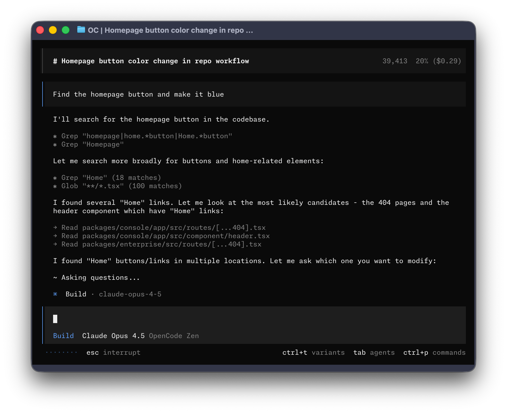

# GPT Image by Ace Data Cloud for OpenCode

Native **OpenCode 2.0.26+** plugin: GPT Image image tools and same-task results,
with a native `/connect` credential entry, hosted MCP and task Skill. It reuses
[OpenAIMCP](https://github.com/AceDataCloud/OpenAIMCP), not a duplicate API/billing client.
Independent Ace integration; not made or endorsed by GPT Image or OpenCode.
[简体中文](readme/README_zh_Hans.md) · [Privacy](PRIVACY.md).

## 1. Install through OpenCode

Check `opencode --version`. OpenCode 1 uses a different plugin API.
[Official plugin installation](https://opencode.ai/v2/docs/plugins/).
The source PR is a candidate: main has no released plugin yet; npm is not published
and official ecosystem inclusion is not claimed. Review the branch, then install:

```bash
opencode plugin add 'git+ssh://git@github.com/AceDataCloud/GPTImageOpenCode.git#codex/native-service-plugin'
```

GitHub shortcut: `opencode plugin add 'github:AceDataCloud/GPTImageOpenCode#codex/native-service-plugin'`.
After reviewed main is published, remove the candidate with `opencode plugin remove`
using the same target, then install `github:AceDataCloud/GPTImageOpenCode`. Never install both.

## 2. Register/sign in and get the right token

Open [Ace Applications](https://platform.acedata.cloud/console/applications?utm_source=github&utm_medium=referral&utm_campaign=evergreen&utm_content=opencode_gptimage_readme_key).
Find **General application**; choose **Initialize General Application** if needed.
Check GPT Image access, balance and [current pricing](https://platform.acedata.cloud/models?utm_source=github&utm_medium=referral&utm_campaign=evergreen&utm_content=opencode_gptimage_readme_pricing).
Copy the API Key, or **Manage Keys → Create** a separate `OpenCode GPT Image` key.


Review expiry, usage limit and **Allowed APIs**. For this basic workflow permit
`/openai/images/generations` and `/openai/tasks`. Advanced operations may require additional APIs.


Screenshots reused from the author-owned SunoDify tutorial commit
`8d3d03570e73324220f111f7fe343da0792a8071`, collected 2026-10-18. These are Ace account
screens, not OpenCode. The shown `Dify tutorial` name is a source example; use
`OpenCode GPT Image`. Copy a raw token without `Bearer `, spaces or quotes. A
`platform-...` management token is not an application key. No trial amount is promised.

## 3. Paste in OpenCode

Reload the plugin, enter `/connect`, choose **GPT Image by Ace Data Cloud →
Ace Data Cloud API Token — GPT Image**, and paste the token. OpenCode stores it;
the plugin resolves it in memory for the fixed `openai.mcp.acedata.cloud` destination.
Without a key the server remains disabled. Use `/mcp` to check its connection.
For env setup, export `ACEDATACLOUD_GPTIMAGE_API_TOKEN` **to the server process**
before starting. Existing background services do not inherit another shell's env;
`opencode --standalone` provides an isolated first session.



Official original collected 2026-10-17, capture date/version unknown. It is a real
OpenCode interface reference, not a screenshot of this plugin's dialog. Native UI
capture is queued, not fabricated. Sources: [SOURCES](docs/SOURCES.md).

## 4. First use and task results

```text
Inspect GPT Image tool schemas only. Do not execute generation or edit tools.
```

Your chat model may bill for conversation even when no service generation runs.
After explicit price/budget approval, submit `openai_generate_image` once. Preserve `task_id`.
Query `openai_get_task(id=...)` with that same ID until the returned task confirms
success and final media URLs. Pending/processing or a preview link is not completion.
Never resubmit a generation to poll. No automatic paid retries or model fallback.
The existing MCP owns response normalization; inspect its current returned status.

## Troubleshooting

| Symptom | Action |
|---|---|
| No entry | Verify OpenCode 2, exact plugin target and reload. |
| Disabled/401/403 | Check raw token, service access, expiry, restrictions and balance. |
| Pending | Query same task ID, do not generate again. |
| 429/5xx/timeout | Keep task/trace ID, inspect original status before new charge. |
| Existing same-name server | User configuration takes precedence; plugin does not overwrite it. |

Model chat and GPT Image charges are separate. Installation/connection is not final
media, unique billing or customer-revenue proof. [Report a problem](https://github.com/AceDataCloud/GPTImageOpenCode/issues).


### Focused GPT Image scope

The shared OpenAI MCP is deliberately filtered in this plugin namespace: only `openai_generate_image`, `openai_edit_image` and `openai_get_task` remain. Generation/edit model enums contain only advertised `gpt-image-*` IDs. Chat, audio, embeddings, DALL-E and Nano Banana tools/models are excluded here; no shared MCP is changed. Unknown upstream model schemas hide the submit tools instead of exposing a broad service. Use `openai_get_task(id=...)`, not a `task_id` argument. Include `/openai/images/edits` in Allowed APIs when editing images.

Generation and edit tools require an explicit `gpt-image-*` model. In particular, the shared edit tool default can be DALL-E; this plugin removes that default instead of sending an unintended model.
